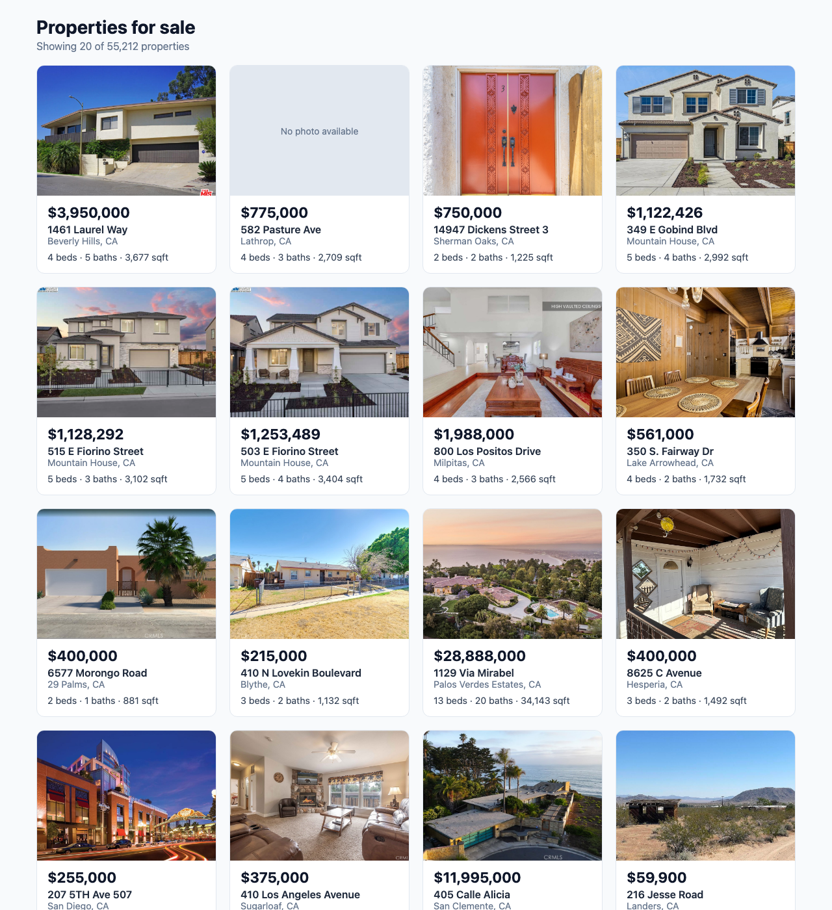

# 🏠 IDX Real Estate Platform

A Zillow/Redfin-style property search app built on real MLS (Multiple Listing Service) data.
This repository contains:
- the **backend** (in `backend/`): a REST API that lets you search California property listings by
  city, ZIP code, price, bedrooms and bathrooms, view a single property, and see its upcoming open houses
- the **frontend** (in `frontend/`): a React app that shows the listings as a grid of property cards

---

## 📸 Screenshot


*The listings page: 20 property cards with photo, price, address, city/state, beds, baths and sqft.*

---

## 🧰 Tech Stack

| Part | Technology | Version |
|---|---|---|
| Runtime | Node.js | 24.14.1 |
| API framework | Express | 5.2.1 |
| MySQL driver | mysql2 | 3.24.5 |
| Config | dotenv | 18.0.4 |
| Cross-origin requests | cors | 2.8.6 |
| Dev auto-restart | nodemon | 1.14.10 |
| Database | MySQL (Docker image `mysql:8`) | 8.4.11 |
| Frontend | React (run with Vite) | React 19.3.0, Vite 8.3.3 |
| Testing (backend) | Jest + Supertest | Jest 30.5.2, Supertest 7.3.1 |
| Testing (frontend) | Jest + React Testing Library (jsdom) | Jest 30.5.2, React Testing Library 16.3.3 |

---

## 🏗️ Architecture

```
┌──────────────────────┐   HTTP (JSON)   ┌──────────────────────┐   SQL    ┌──────────────────────┐
│   React frontend     │ ──────────────▶ │     Express API      │ ───────▶ │   MySQL in Docker    │
│   (Vite dev server)  │ ◀────────────── │     (backend/)       │ ◀─────── │  container:          │
│   localhost:3000     │                 │   localhost:5000     │          │  idx-mysql-local     │
└──────────────────────┘                 └──────────────────────┘          │  localhost:3306      │
                                                                           │  database: rets      │
                                                                           └──────────────────────┘
```

**The React app never talks to MySQL directly.** It only calls the Express API. The API is the
only part that knows the database password, checks every request, and decides which data to send back.

> The frontend runs on port 3000 (set in `frontend/vite.config.js`; Vite's default is 5173).
> Its dev server forwards every `/api/...` request to `http://localhost:5000` (a **proxy**), so the
> React code only calls `/api/...`. The guide's `"proxy"` line in `package.json` is for Create React App;
> Vite ignores it.

### Project structure
```
.
├── backend/
│   ├── app.js               # Builds the Express app: request logger, CORS, routes, 404 and error handlers
│   ├── server.js            # Starts the app on port 5000
│   ├── db.js                # MySQL connection pool (reads settings from .env)
│   ├── routes/
│   │   └── properties.js    # /api/properties endpoints + listing ID validation
│   ├── __tests__/
│   │   └── properties.test.js  # Supertest tests for every endpoint
│   ├── sql/
│   │   └── indexes.sql      # Database indexes for fast searching
│   ├── .env.example         # Template for your .env file (placeholders only)
│   └── package.json
├── frontend/
│   ├── src/
│   │   ├── api/client.js                # All calls to the backend; throws clear errors (+ client.test.js)
│   │   ├── utils/property.js            # Safe formatting + photo parsing (+ property.test.js)
│   │   ├── components/PropertyCard.jsx  # One property card; .css: hover effect (+ PropertyCard.test.jsx)
│   │   ├── pages/ListingsPage.jsx       # Loading, error, count, grid (+ ListingsPage.test.jsx)
│   │   ├── App.jsx                      # Shows ListingsPage
│   │   └── main.jsx                     # Starts React
│   ├── vite.config.js                   # Port 3000 + /api proxy
│   ├── jest.config.js, jest.setup.js    # Jest settings (pretend browser page, extra checks)
│   ├── babel.config.cjs                 # Lets Jest read JSX (Vite doesn't use it)
│   └── package.json
├── docs/                    # Weekly notes (week-1.md … week-5.md), milestone-log.md, images/
├── README.md
└── .gitignore               # Keeps .env and node_modules out of git (for every folder)
```

---

## 🚀 Local Setup (from a fresh computer)

### 1. Install the prerequisites
- [Node.js](https://nodejs.org/) 18 or newer (developed with 24.14.1) — includes `npm`
- [Docker Desktop](https://www.docker.com/products/docker-desktop/) — **open it** before running Docker commands
- [Git](https://git-scm.com/downloads)

### 2. Get the code and install packages
```bash
git clone https://github.com/simranpreetdhanoa/IDX-Exchange-SDE.git
cd IDX-Exchange-SDE/backend
npm install
```

### 3. Start MySQL in Docker
Pick your own password and use it in place of `<your-password>`:
```bash
docker run --name idx-mysql-local -e MYSQL_ROOT_PASSWORD=<your-password> -p 3306:3306 -d mysql:8
```
Wait about 20 seconds for MySQL to start, then check it's ready:
```bash
docker exec idx-mysql-local sh -c 'mysqladmin ping -u root -p"$MYSQL_ROOT_PASSWORD"'
# → mysqld is alive
```
> After restarting your computer, start the container again with `docker start idx-mysql-local`.

### 4. Create the database and import the data
The data files `rets_property.sql` and `rets_openhouse.sql` are **SQL files provided by IDX Exchange**.
They are not in this repository (they are several hundred MB).
**Keep them outside the project folder** so they can never be committed by accident — for example in
`~/idx-data/`. Then run (change the path if you saved them somewhere else):
```bash
docker exec idx-mysql-local sh -c 'mysql -u root -p"$MYSQL_ROOT_PASSWORD" -e "CREATE DATABASE IF NOT EXISTS rets"'
docker exec -i idx-mysql-local sh -c 'mysql -u root -p"$MYSQL_ROOT_PASSWORD" rets' < ~/idx-data/rets_property.sql
docker exec -i idx-mysql-local sh -c 'mysql -u root -p"$MYSQL_ROOT_PASSWORD" rets' < ~/idx-data/rets_openhouse.sql
```
These commands use the password you set in step 3, so you don't have to type it. Each import can take a few minutes.

### 5. Add the search indexes
Open a MySQL shell:
```bash
docker exec -it idx-mysql-local mysql -u root -p rets
```
Then run:
```sql
SET SESSION sql_mode = '';
```
and paste the `CREATE INDEX` statements from [`backend/sql/indexes.sql`](backend/sql/indexes.sql), **removing the words
`IF NOT EXISTS`** from each one. Type `exit` when done.
> Why: MySQL 8 rejects `CREATE INDEX IF NOT EXISTS`, and its strict mode rejects some old column
> defaults in the imported table (Error 1067). See [Known issues](#-known-issues-and-future-improvements).

### 6. Create your `.env` file
Still inside the `backend/` folder:
```bash
cp .env.example .env
```
Open `backend/.env` and set `DB_PASSWORD` to the password from step 3. **Never commit `.env`** — it is listed in `.gitignore`.

### 7. Run the API
From the `backend/` folder:
```bash
npm run dev
```
You should see `Server listening on http://localhost:5000`. In a second terminal:
```bash
curl http://localhost:5000/api/health
# {"status":"ok","database":"connected"}
```
Every request is logged in the first terminal, e.g.
`[2026-10-14T10:23:25.721Z] GET /api/health 200 - 26ms`. Stop the server with `Ctrl + C`.

### 8. Run the frontend
Keep the API running, and in a **new terminal**:
```bash
cd IDX-Exchange-SDE/frontend
npm install
npm run dev
```
Open **http://localhost:3000**. You should see "Showing 20 of 55,212 properties" and a grid of cards.
If the API isn't running, the page shows: *"Couldn't load properties. Cannot reach the backend…"*

---

## 🧪 Testing

Both parts have automatic tests that run with `npm test` (the tools from the internship guide).

| Part | Tools | Tests | What they check |
|---|---|---|---|
| Backend | Jest + Supertest | 14 | Every endpoint: health, property (200/404/400), open houses, search filters and validation, unknown routes |
| Frontend | Jest + React Testing Library | 57 | Photo parsing and formatting, the API client's error messages, the property card, and the listings page (loading, error, count) |

```bash
# backend — MySQL (Docker) must be running; the tests use the real database
cd backend
npm test

# frontend — no backend needed (the API calls are replaced by mocks)
cd frontend
npm test
```
Expected: `Tests: 14 passed, 14 total` and `Tests: 57 passed, 57 total`.

> The backend test output starts with a harmless `console.error` box: it's dotenv's
> "injected env from .env" message, not a failing test.

---

## 📡 API Reference

Base URL: `http://localhost:5000/api` · All responses are JSON.

| Method | Endpoint | What it does | Status codes |
|---|---|---|---|
| GET | `/health` | Checks the API can reach the database | 200, 500 |
| GET | `/properties` | Searches properties with filters and pagination | 200, 400, 500 |
| GET | `/properties/:id` | Returns one property by listing ID | 200, 400, 404, 500 |
| GET | `/properties/:id/openhouses` | Returns a property's open houses, sorted by date then start time | 200, 400, 404, 500 |

### `GET /health`
```bash
curl http://localhost:5000/api/health
```
```json
{ "status": "ok", "database": "connected" }
```
**500** if the database can't be reached: `{ "status": "error", "database": "disconnected", "message": "..." }`

### `GET /properties`
| Query parameter | Example | Meaning |
|---|---|---|
| `city` | `Mountain House` | Exact city name (upper/lower case and extra spaces ignored) |
| `zipcode` | `95391` | Exact ZIP code |
| `minPrice` | `500000` | Price at least this much |
| `maxPrice` | `1500000` | Price at most this much |
| `beds` | `3` | At least this many bedrooms (whole number) |
| `baths` | `2` | At least this many bathrooms |
| `limit` | `20` | Results per page, 1–100 (default 20) |
| `offset` | `40` | Number of results to skip (default 0) — `offset=40&limit=20` is page 3 |

```bash
curl "http://localhost:5000/api/properties?city=Mountain%20House&beds=5&limit=1"
```
```json
{
  "total": 16,
  "limit": 1,
  "offset": 0,
  "results": [
    { "L_ListingID": "1118381441", "L_Address": "349 E Gobind Blvd", "L_City": "Mountain House",
      "L_SystemPrice": 1122426, "L_Keyword2": 5, "LM_Dec_3": "4.0", "...": "..." }
  ]
}
```
**400** examples:
- `?limit=500` → `{ "error": "limit must be an integer between 1 and 100" }`
- `?minPrice=abc` → `{ "error": "minPrice must be a valid non-negative number" }`
- `?minPrice=900000&maxPrice=100000` → `{ "error": "minPrice cannot be greater than maxPrice" }`

### `GET /properties/:id`
`:id` is the **listing ID** (`L_ListingID`): digits only, up to 20 characters.
```bash
curl http://localhost:5000/api/properties/1118381441
```
```json
{ "L_ListingID": "1118381441", "L_Address": "349 E Gobind Blvd", "L_City": "Mountain House",
  "L_Zip": "95391", "L_SystemPrice": 1122426, "L_Keyword2": 5, "LM_Dec_3": "4.0",
  "L_Status": "Active", "...": "126 fields in total" }
```
- **400** `/properties/abc123` → `{ "error": "Invalid listing ID. It must contain only digits (max 20 characters)." }`
- **404** `/properties/999999999` → `{ "error": "No property found with listing ID 999999999. Check the ID and try again." }`

### `GET /properties/:id/openhouses`
```bash
curl http://localhost:5000/api/properties/1118381441/openhouses
```
```json
[
  { "id": 7062, "L_ListingID": "1118381441", "OH_StartDate": "2026-09-20T07:00:00.000Z",
    "OH_StartTime": "13:00:00", "OH_EndTime": "16:00:00", "all_data": "{...}", "...": "..." }
]
```
- A property with **no** open houses returns **200** with `[]` (not an error).
- **400** for a malformed ID, **404** if the property doesn't exist (same messages as above).
- `all_data` is the original open house record from the MLS feed, returned as a JSON string.

### Errors in general
- **400** — something is wrong with the request (bad ID, bad filter, malformed JSON body).
- **404** — the property, or the route itself, doesn't exist.
- **500** — something went wrong on the server (e.g. the database is down):
  `{ "error": "Internal Server Error" }`. Full details are printed in the server log only.

---

## 🗄️ Database Schema Summary

Database: `rets` — two tables from the MLS data feed. Column names follow the RETS standard,
so many of them are not self-explanatory.

### `rets_property` — one row per listing (~55,000 rows, 126 columns)
| Column | Meaning |
|---|---|
| `L_ListingID` | Listing ID (e.g. `1118381441`) — used by the API as `:id` |
| `id` | Internal row number (not used by the API) |
| `L_Address`, `L_City`, `L_State`, `L_Zip` | Address |
| `L_SystemPrice` | Price |
| `L_Keyword2` | Bedrooms |
| `LM_Dec_3` | Bathrooms |
| `LM_Int2_3` | Living area in sq ft (appears to be — e.g. 2,992) |
| `L_Class` / `L_Type_` | Category / property type (e.g. `Residential` / `SingleFamilyResidence`) |
| `L_Status` | Listing status (e.g. `Active`) |
| `YearBuilt`, `LotSizeSquareFeet` | Year built, lot size |
| `L_Remarks` | Description text |
| `L_Photos`, `PhotoCount` | Photo URLs (JSON list) and how many |

### `rets_openhouse` — one row per open house (~13,400 rows, 13 columns)
| Column | Meaning |
|---|---|
| `L_ListingID` | Which listing this open house belongs to |
| `OH_StartDate`, `OH_StartTime`, `OH_EndTime` | When it happens |
| `all_data` | The full original record from the feed (JSON text) |

### How they're linked
```
rets_property.L_ListingID  1 ──────< many  rets_openhouse.L_ListingID
```
One property can have zero, one or many open houses. The link is by matching `L_ListingID`
values; there is **no foreign key** enforcing it (see Known issues).

---

## 📅 Progress

- [x] **Week 1** — Database setup: MySQL in Docker, data import, connection pool ([notes](docs/week-1.md))
- [x] **Week 2** — Express server and `/api/health` ([notes](docs/week-2.md))
- [x] **Week 3** — Property search: filters, pagination, validation, indexes ([notes](docs/week-3.md))
- [x] **Week 4** — Property detail and open house endpoints, request logging, error handling ([notes](docs/week-4.md))
- [x] **Week 5** — React frontend: property grid, API client, loading/error states, safe photo parsing ([notes](docs/week-5.md))
- [ ] **Week 6**
- [ ] **Week 7**
- [ ] **Week 8**
- [ ] **Week 9**
- [ ] **Week 10**
- [ ] **Week 11**
- [ ] **Week 12**

The detailed command log from Weeks 1–3 is in [docs/milestone-log.md](docs/milestone-log.md).

---

## ⚠️ Known Issues and Future Improvements

**Known issues**
- **Photos:** 211 properties have no photos (`L_Photos` is an empty string), and in a sample about
  4–6% of photo URLs lead to a 404 or a PDF. The cards show "No photo available" in both cases.
- **Square meters:** 7 listings store living area in square meters; the cards show the number as sqft.
- **Grammar:** a property with 1 bathroom shows "1 baths".
- **Backend tests use the real database:** MySQL must be running, and they rely on a few known
  listings (e.g. `1118381441`). A separate test database would make them independent.
- **`npm audit` warnings:** mostly from the old **nodemon 1.14.10** in the backend; a few from the
  frontend's test packages (development-only).
- **Not covered by automatic tests:** the hover effect and running on port 3000 (checked by hand in a browser).
- **`backend/sql/indexes.sql` doesn't run as-is on MySQL 8:** it uses `CREATE INDEX IF NOT EXISTS` and doesn't
  turn off strict mode first (see setup step 5 for the workaround).
- **Dates** come back as UTC timestamps (e.g. `2026-09-20T07:00:00.000Z`) instead of plain dates.
- **Data quality:** ~1,300 open houses point to properties that don't exist ("orphans"), and 3 listing
  IDs appear twice in `rets_property`.
- `rets_openhouse` uses the older **MyISAM** storage engine: no transactions and no foreign keys.
- The health check returns the raw database error message when the database is down.
- Error responses use slightly different shapes across endpoints.

**Future improvements**
- Fix `backend/sql/indexes.sql` so it runs on MySQL 8 without edits.
- Return plain dates (`dateStrings` option in `db.js`).
- Clean up orphan open houses and duplicates, convert `rets_openhouse` to InnoDB, add a foreign key.
- Use one consistent error format and hide internal error details in `/api/health`.
- Add pagination, search filters and a property detail page to the frontend.
- Upgrade nodemon to clear the `npm audit` warnings.
- Use a separate test database for the backend tests.
- Remove unused template files (`lucide-react`, `hero.png`, logo `.svg`s).
