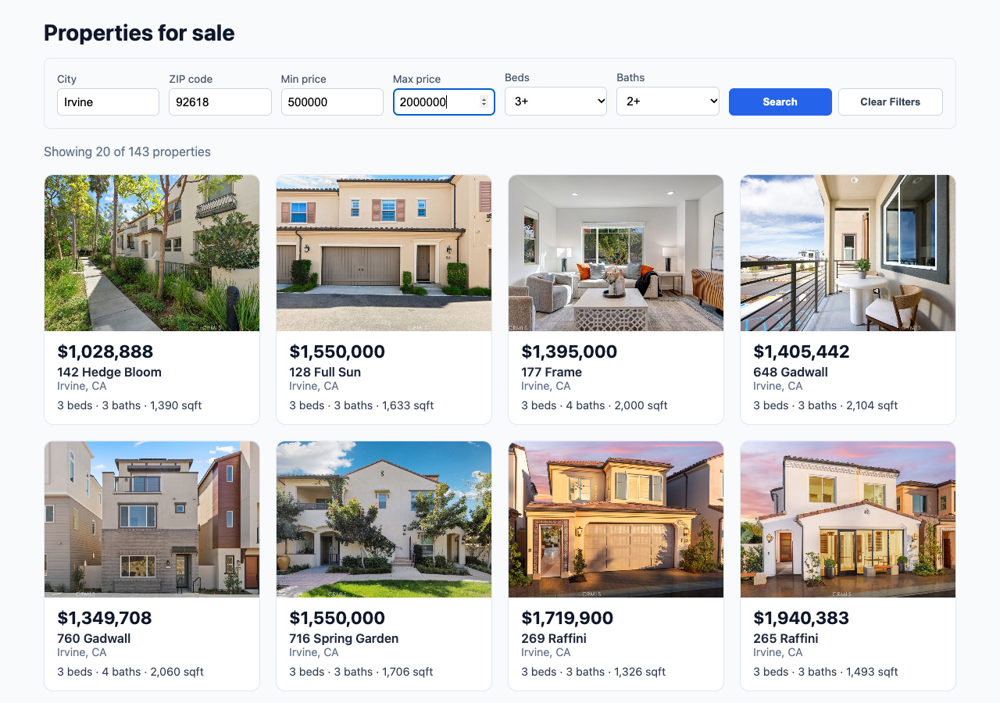

# Week 6 — Filters UI + Introduction to Testing

> ✅ All steps done: filter form works with real data (13/13 browser checks), debug challenge
> fixed and proven in Chrome, **87 automatic tests pass** (73 frontend + 14 backend).

## Goal
A working filter form and my first unit tests.

| # | Requirement | In plain English |
|---|---|---|
| 27 | `PropertyFilters` component | A form with 6 inputs: city, ZIP, min price, max price, beds (dropdown), baths (dropdown) |
| 28 | Filters in `ListingsPage` | Search reloads the grid with matching homes only |
| 29 | "Clear Filters" button | Empties the form and shows all homes again |
| 30 | ≥ 3 API client tests | Had 11 from Week 5 Part C; added 1 more → **12** |
| 31 | ≥ 3 `PropertyFilters` tests | **6** new tests |

**Acceptance criteria:** six inputs shown · Search fetches matching results ·
filters can be combined · empty values not sent to the API · Clear resets form
and results · helpful "no properties found" message · `npm test` passes ·
I can explain: unit test, mocking, why we mock `fetch()`.

**Debug challenge 🐛:** type a city → Search → Clear → type a new city → Search:
the first results briefly flash. Find why and fix it.

## Plan
| Step | What | Status |
|---|---|---|
| 0 | Branch `week-6` + this notes file | ✅ |
| 1 | `PropertyFilters` component | ✅ |
| 2 | Connect it to `ListingsPage` | ✅ |
| 3 | Clear Filters button | ✅ |
| 4 | Helpful "no results" message | ✅ |
| 5 | Debug challenge | ✅ |
| 6 | Tests | ✅ |
| 7 | Full acceptance check | ✅ |
| 8 | Notes + PR | ✅ |

---

## Key ideas (the shopping list comparison)

The filter form is like a **shopping list on a notepad**:
- The **notepad** is React *state*: one object holding all six answers.
- Each time I type, React **copies the list and changes one line** (the spread operator).
- **Search** hands the list to the page; the page asks the backend for matching homes.
- **Clear** tears off the page and starts a blank one.
- Before sending, we **cross out the blank lines** (`removeEmptyFilters`) so the backend
  only sees what I actually asked for.

### Words to know
| Word | Meaning |
|---|---|
| **State** | A component's memory. When it changes, React redraws the component. |
| **Controlled input** | An input whose value comes from state, so React is the "single source of truth" |
| **Props** | Values a parent passes into a child component, like `onSearch` |
| **Callback** | A function handed to someone else to call later ("call me when you're done") |
| **Spread operator `...`** | Copies all fields of an object: `{ ...filters, city: 'Irvine' }` = copy, then change `city` |
| **Unit test** | A small automatic check of one piece of code, on its own |
| **Mock** | A pretend version of something (like `fetch`) that we control in a test |

---

## Step 1 — `PropertyFilters` ✅ (`frontend/src/components/PropertyFilters.jsx` + `.css`)

### What & why
A form component with six inputs and two buttons. It keeps all six values in **one state
object** (the guide's hint) and tells the page about Search and Clear through two props:
`onSearch(filters)` and `onClear()`. It doesn't fetch anything itself — it just collects input.

### First: check the facts
The backend uses `>=` for beds and baths (`L_Keyword2 >= ?`, `LM_Dec_3 >= ?`), so the
dropdowns say **1+, 2+, 3+…** ("at least"), not "exactly 3".

### The code, explained
```jsx
const [filters, setFilters] = useState(EMPTY_FILTERS);
```
The notepad. Starts as six empty strings (`EMPTY_FILTERS` in `utils/filters.js`). Empty = "any".

```jsx
function handleChange(event) {
  const { name, value } = event.target;
  setFilters({ ...filters, [name]: value });
}
```
**One handler for all six inputs.** `event.target` is the input that changed. Its `name`
(e.g. `"city"`) says which field to update. `{ ...filters, [name]: value }` copies the whole
object and replaces just that one field. `[name]` with square brackets means "use the
*value* of `name` as the key" — so it becomes `city: 'Irvine'`.

Why copy instead of `filters.city = 'Irvine'`? React only redraws when it gets a **new**
object. Changing the old one in place is like editing a photo after it's been printed —
React wouldn't notice.

```jsx
function handleSubmit(event) {
  event.preventDefault();
  onSearch(filters);
}
```
A form's default behaviour is to reload the whole page. `preventDefault()` stops that.
Then we hand the notepad to the page. Because this is the form's `onSubmit`, pressing
**Enter** in any box also searches.

```jsx
function handleClear() {
  setFilters(EMPTY_FILTERS);
  onClear();
}
```
Blank notepad, then tell the page to reload everything.

```jsx
<input name="city" value={filters.city} onChange={handleChange} ... />
```
A **controlled input**: what you see in the box always comes from state (`value=`),
and typing goes through `onChange` back into state.

```jsx
<button type="submit">Search</button>
<button type="button" onClick={handleClear}>Clear Filters</button>
```
`type="button"` matters: inside a form, a button is "submit" by default — without it,
Clear would also trigger a search.

**CSS:** a grid of 130px+ columns that wrap on small screens; the button pair spans two
columns so both fit (see Problems).

---

## Step 2 — Connect to `ListingsPage` ✅ (`frontend/src/pages/ListingsPage.jsx`)

### What changed
1. **New state `search`** — the filters of the latest search (`{}` = all properties).
2. **`useEffect(..., [search])`** — before, the effect ran once (`[]`). Now it runs on first
   load **and every time `search` changes**. That's where the fetch happens.
3. **`startSearch(filters)`** — used by Search and Clear: shows "Loading…", clears old
   errors, and saves a **new** object into `search` (`{ ...filters }`), which triggers the effect.
   A new object every time means clicking Search twice with the same filters still re-fetches.
4. **The form is always on screen.** In Week 5 the page returned early with just
   "Loading…" or the error. Now only the part *below* the form changes (`content`), so
   what I typed is never wiped out by a loading screen or an error.

```jsx
const data = await fetchProperties({ ...removeEmptyFilters(search), limit: PAGE_SIZE });
```
Take the filters, remove blank ones, add `limit: 20`, ask the backend.

### `removeEmptyFilters` (`frontend/src/utils/filters.js`)
Loops over the object and keeps only values that aren't empty after trimming spaces.
`{ city: ' Irvine ', zipcode: '', beds: '3' }` → `{ city: 'Irvine', beds: '3' }`.
The API client also skips empty values (Week 5) — this is a second, deliberate layer that
also catches "spaces only".

## Step 3 — Clear Filters ✅
Built into Step 1 (button) and Step 2 (`onClear={() => startSearch({})}`).

## Step 4 — Helpful "no results" ✅
Instead of only "No properties found.", the box now says what to try: another city or
ZIP, a wider price range, fewer beds/baths — or click **Clear Filters**.

---

## Step 5 — Debug challenge 🐛 ✅ (`ListingsPage.jsx`, the `useEffect`)

### The bug
Type a city → Search → Clear → type a new city → Search: the wrong results show up for a moment
(or even stay). On my laptop it's too fast to see, because the database answers in milliseconds.

### The detective trail (hints → my answers)
1. **Hint:** Search → Clear → Search sends three requests. Does anything make sure the answers come
   back in the same order?
   → I wasn't sure, so we walked through a timeline: Clear sends **A** ("all homes", a bigger, slower
   job), Search sends **B** ("Irvine"). B arrives at 0.3 s, A arrives *late* at 0.8 s.
2. **Question:** the page puts *any* answer on screen when it arrives. What's left on screen at the end?
   → **Me: "the previous search ones."** ✅ The old answer A overwrites the newer B.
3. **Hint:** we can't make the network faster; the page must ignore answers it no longer wants.
   → **Me: "it should stop searching A and start working on the one I asked."** ✅
   The moment I click Search, A is no longer wanted.
4. **Hint:** `useEffect` can return a **cleanup** function that React runs just before the effect runs
   again. → We wrote the fix together from my idea.

### The answer: a race condition
Two requests "race"; whichever finishes **last** wins the screen, even if it's the old one.
Like ordering two pizzas, cancelling the first, and eating whichever arrives last.

### The fix
```jsx
useEffect(() => {
  let cancelled = false;              // each search gets its own "cancelled" switch

  async function load() {
    try {
      const data = await fetchProperties(...);
      if (cancelled) return;          // old answer arrived late → ignore it
      setProperties(data.results);
      ...
    } catch (err) {
      if (!cancelled) setError(err.message);
    } finally {
      if (!cancelled) setLoading(false);
    }
  }
  load();

  return () => {                      // cleanup: React runs this when "search" changes
    cancelled = true;                 // → flips the OLD search's switch
  };
}, [search]);
```
- Every time the effect runs it makes a **new** `cancelled` variable, starting as `false`.
- When I click Search again, `search` changes, so React first runs the **cleanup** of the previous
  run → the old search's `cancelled` becomes `true`.
- When the old answer finally arrives, it checks its own switch, sees `true`, and does nothing.
- The new search has its own switch (still `false`), so its answer is shown.
- Error and "loading finished" are guarded too, so an old failure can't show an error box either.

### Proof 1 — a test that fails without the fix
`ListingsPage.test.jsx` → *"ignores a slow old answer that arrives after a newer search"*.
The mock holds back the two answers, then releases **B first, A second**.
- Without the fix: ❌ fails at the line *after* A arrives — "Unable to find: New: Irvine home".
- With the fix: ✅ passes.

### Proof 2 — real Chrome with the "all homes" request slowed down by 1.5 s
| | 0 ms | 100 ms | 1500 ms (old answer arrives) |
|---|---|---|---|
| Without fix | Loading… | Irvine: 723 | **all 55,212** ❌ |
| With fix | Loading… | Irvine: 723 | **stays 723** ✅ |

### Why the other tests didn't catch it
Mocks answer instantly and in order, so they never create a race. The new test deliberately
answers out of order.

---

## Step 6 — Tests ✅

### Unit test, mocking, why mock `fetch()` — in my own words
- **Unit test:** a tiny program that checks one piece of my code gives the right answer,
  e.g. "if I fill City and click Search, `onSearch` gets `{ city: 'Irvine', ... }`".
  It runs in about a second, every time, with `npm test`.
- **Mocking:** replacing a real thing with a pretend one I control. Like a flight
  simulator: pilots practise engine failures without a real plane.
- **Why mock `fetch()`:** the real `fetch` needs the backend and database running, the data
  can change, and I can't easily make the server fail on demand. With `global.fetch = jest.fn()`
  I decide the answer (success, 404, 500, "server down"), so tests are fast, repeatable,
  and can test the error paths.

### What's new
| File | Tests | What they check |
|---|---|---|
| `components/PropertyFilters.test.jsx` | **6 new** | six inputs + two buttons, empty at start · dropdown options (Any, 1+…) · all six filters combined in one object · typing in one input keeps the others (spread) · Enter also searches · Clear empties every input and calls `onClear`, not `onSearch` |
| `api/client.test.js` | 11 → **12** | new: all six filters together build the right URL. Existing ones already mock `fetch` with `jest.fn()` and test success **and** errors (400, 404, 500, 502, server down) |
| `utils/filters.test.js` | **4 new** | blank form → `{}` · keeps only filled values · trims spaces · handles `null`/`undefined` |
| `pages/ListingsPage.test.jsx` | 3 → **8** | form shown · Search sends only filled-in filters (`' Irvine '` → `'Irvine'`) · Clear empties form and reloads with `{ limit: 20 }` · a failed search keeps what I typed · helpful no-results message · race condition (debug challenge) |

**Two kinds of mock this week:**
- `onSearch = jest.fn()` — a pretend callback. Afterwards I ask it "were you called, and with what?"
- `jest.mock('../api/client')` — the whole API client is pretend in the page tests, so no backend needed.

### Results
```
Frontend: Test Suites: 6 passed · Tests: 73 passed   (Week 5: 57)
Backend:  Test Suites: 1 passed · Tests: 14 passed
Lint:     no problems
```

---

## Step 7 — Full acceptance check ✅

### API vs database (through the website's proxy on port 3000)
Each filter combination's `total` compared with a `SELECT COUNT(*)` straight in MySQL:

| Filters | API | DB |
|---|---|---|
| (none) | 55,212 | 55,212 ✅ |
| city=Irvine | 723 | 723 ✅ |
| zipcode=92618 | 269 | 269 ✅ |
| minPrice=500000 & maxPrice=900000 | 19,774 | 19,774 ✅ |
| beds=3 (3+) | 39,661 | 39,661 ✅ |
| baths=2 (2+) | 48,515 | 48,515 ✅ |
| Los Angeles + $500k–$900k | 1,266 | 1,266 ✅ |
| San Diego + 3+ beds + 2+ baths | 999 | 999 ✅ |
| **all six:** Irvine, 92618, $500k–$2M, 3+ beds, 2+ baths | 143 | 143 ✅ |
| city=Atlantis | 0 | 0 ✅ |
| minPrice > maxPrice | `400 {"error":"minPrice cannot be greater than maxPrice"}` ✅ | |

### In a real browser (headless Chrome, clicking and typing like a user)
| Check | Result |
|---|---|
| Form shows six inputs | ✅ City, ZIP code, Min price, Max price, Beds, Baths |
| First load | ✅ Showing 20 of 55,212 |
| City = Irvine | ✅ 723, cards say Irvine |
| All six combined | ✅ 143 |
| Clear empties the form | ✅ all six blank / Any |
| Clear reloads everything | ✅ 55,212, request = `/api/properties?limit=20` |
| Empty values not sent | ✅ only Beds 4+ filled → `/api/properties?beds=4&limit=20` |
| Search → Clear → Search → Clear | ✅ 2,198 (San Diego) → 55,212 |
| No results | ✅ helpful message, 0 cards |
| Min > max | ✅ error box, typed prices kept |
| Phone width (390px) | ✅ two columns, no sideways scroll |
| Console | Only Chrome's "Failed to load resource: 400" from the min>max check — expected |



### Week 6 checkpoint
- [x] All filter combinations return correct results
- [x] Clear filters works correctly in all sequences (also with a slow network — Step 5)
- [x] All tests pass with `npm test`
- [x] Debug challenge (Step 5)

---

## Problems we hit
| Problem | Cause | Fix |
|---|---|---|
| Lint: "Calling setState synchronously within an effect" | My first version called a function from `useEffect` that did `setLoading(true)` straight away | Keep the latest search in state; the effect only fetches. `setLoading(true)` happens in the click handler instead |
| Page test counts added up across tests | Mocks remember calls from earlier tests | `beforeEach(() => jest.resetAllMocks())` |
| 7 backend tests failed | Docker Desktop wasn't running, so no database | Opened Docker, `docker start idx-mysql-local` → 14/14 |
| "Clear Filters" stuck out past the grey box | Two buttons squeezed into one 150px column | Columns 130px+, buttons span 2 columns |
| Blank photos in the first screenshot | Screenshot taken before images downloaded | Wait for the network to go quiet, then screenshot |
| `-p"$MYSQL_ROOT_PASSWORD"` → access denied | The container's saved password is older than the real one | Use the password from `.env` without printing it |

## Questions my supervisor may ask
- **What was the debug challenge bug?** → A race condition: an old, slow answer arrived after a newer
  one and overwrote it. Fixed with a `cancelled` switch flipped by the `useEffect` cleanup.
- **Why didn't your tests catch the race at first?** → Mocks answer instantly and in order. I added
  a test that answers out of order.
- **Could you cancel the request itself instead?** → Yes, with `AbortController` (stops the download
  too). The `cancelled` switch is simpler and enough here, because the answer is just ignored.
- **What is a unit test? What is mocking? Why mock `fetch()`?** → see Step 6.
- **The guide asks for 3 API client tests — where are they?** → `api/client.test.js` has 12;
  11 from Week 5 Part C already mock `fetch` and test success and errors, +1 for combined filters.
- **Why one state object instead of six `useState`s?** → One handler for every input,
  easy to reset (`EMPTY_FILTERS`), easy to send as a whole.
- **Why the spread operator?** → React needs a *new* object to notice a change.
- **Why remove empty values if the API client already skips them?** → The guide asks for it,
  it also catches "spaces only", and it keeps the page's intent clear. Two layers of safety.
- **Why does "3" in Beds mean 3 *or more*?** → The backend uses `>=`; the dropdown says "3+" to match.
- **Why doesn't the form disappear while loading?** → It would lose what the user typed.
- **What happens with min price > max price?** → The backend returns 400; the page shows
  the message in red and keeps the inputs. (Possible improvement: check this in the form before sending.)
- **Why `type="button"` on Clear?** → Inside a form, buttons submit by default.

## Still to do / ask
- Optional: check min > max in the form before calling the API.
- Optional: put the filters in the URL (`?city=Irvine`) so a search can be shared or bookmarked.
- Week 7 (pagination) will need the current filters when moving to page 2 — they're already in `search` state.
- Carried over from Week 5: nodemon upgrade, "1 baths" → "1 bath", unused `lucide-react`.
