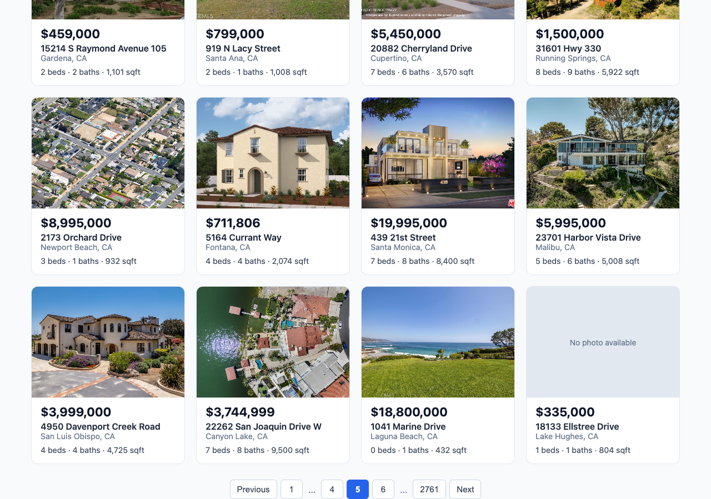

# Week 7 — Pagination

> ✅ Built and tested: **120 automatic tests pass** (106 frontend + 14 backend), lint is clean,
> and all 26 checks passed in real Chrome with real data.

## Goal
Working pagination controls and comprehensive component tests.

| # | Requirement | In plain English |
|---|---|---|
| 32 | Pagination state in `ListingsPage` | The page remembers `currentPage` and `itemsPerPage` |
| 33 | `Pagination` component | Previous, page numbers, `...`, Next |
| 34 | Changing page | Scrolls to the top and keeps the active filters |
| 35 | Changing filters | Goes back to page 1 |
| 36 | Tests | Cover every Pagination behavior |

**Debug challenge 🐛:** the component renders `1 ... 2 3 4 ... 1`. Write a test that reproduces
it, then fix the page number logic.

## Plan
| Step | What | Status |
|---|---|---|
| 0 | Branch `week-7` + check the current code | ✅ |
| 1 | Debug challenge: failing tests, then the page number logic | ✅ |
| 2 | `Pagination` component and tests | ✅ |
| 3 | Connect it to `ListingsPage` and tests | ✅ |
| 4 | Check with real data in real Chrome | ✅ |
| 5 | Notes | ✅ |
| 6 | Commit and pull request | ⬜ waiting for my OK |

---

## Key idea (the book comparison)
The results are like a **book**, and the backend hands over one page at a time.
- `currentPage` is the **bookmark**.
- `itemsPerPage` is **how many homes fit on a page** (20).
- `offset` is **how many homes to skip** to reach the page: `(currentPage - 1) * itemsPerPage`.
  Page 3 skips 40.
- The filters are **which book I'm reading**. A new search is a new book, so the bookmark goes back to page 1.
  Turning a page stays in the same book, so the filters stay.

### Words to know
| Word | Meaning |
|---|---|
| **Pagination** | Showing a long list one page at a time |
| **Offset** | How many results to skip before the ones you want |
| **Ellipsis** | The `...` that stands in for hidden page numbers |
| **Disabled button** | A button that can't be clicked |
| **Regression test** | A test that keeps a fixed bug from coming back |
| **Batching** | React groups several state changes from one click into one redraw |

---

## Step 1 — Debug challenge 🐛 (`frontend/src/utils/pagination.js`)

### Reproducing it
The tests came first (`pagination.test.js`), run against a first version that always builds the same row:
```js
return [1, '...', currentPage - 1, currentPage, currentPage + 1, '...', totalPages];
```
**6 of 10 tests failed.** Examples of what it produced:

| Page | Output | Problem |
|---|---|---|
| 3 of 1 | `1 ... 2 3 4 ... 1` | The exact output in the assignment |
| 23 of 24 | `1 ... 22 23 24 ... 24` | The last page appears twice |
| 1 of 5 | `1 ... 0 1 2 ... 5` | Page 0, and page 1 twice |

**A note on the assignment's example:** it says the *last page* appears twice "near the end". Page 23 of 24
shows exactly that. The literal `1 ... 2 3 4 ... 1` only comes from a current page past the end (page 3 of 1).
The tests cover both.

### The cause
The first version never looks at **where** the current page is. It always adds the first page, the two neighbours
and the last page, even when those overlap.

### The fix: four cases
| Case | When | Example |
|---|---|---|
| 1. All fit | 7 pages or fewer | `1 2 3 4 5` |
| 2. Near the start | current page below 5 | `1 2 3 4 5 ... 24` |
| 3. Near the end | current page in the last 4 | `1 ... 20 21 22 23 24` |
| 4. Middle | everything else | `1 ... 4 5 6 ... 24` |

### Proof
All tests pass after the fix. One test tries **every page of every size from 1 to 30 pages** and checks that no
number appears twice.

---

## Step 2 — `Pagination` component (`frontend/src/components/Pagination.jsx` + `.css`)
It takes three props: `currentPage`, `totalPages`, `onPageChange`. It doesn't fetch anything or
remember anything; it draws the row and reports clicks.

```jsx
if (totalPages <= 1) {
  return null;
}
```
In React, returning `null` means "draw nothing". This hides the controls when there's only one page.

```jsx
disabled={currentPage === 1}
```
Previous can't be clicked on page 1. Next does the same with `totalPages`.

```jsx
getPageNumbers(currentPage, totalPages).map((item, index) => item === '...' ? <span>... : <button>...)
```
Goes through the list. `...` becomes plain text, and a number becomes a button.

- `aria-current="page"` tells screen readers (and the tests) which page is the current one.
- The current page's button is disabled, so clicking it doesn't reload the same page.

## Step 3 — Connect to `ListingsPage` (`frontend/src/pages/ListingsPage.jsx`)
```jsx
const [currentPage, setCurrentPage] = useState(1);
const [itemsPerPage] = useState(PAGE_SIZE);
const offset = (currentPage - 1) * itemsPerPage;
```
The two pieces of state, and the sum the backend needs. `itemsPerPage` never changes yet, so only the value is kept.

```jsx
useEffect(() => { ... }, [search, offset, itemsPerPage]);
```
The effect now also fetches when the page changes. The Week 6 `cancelled` switch protects pages from
the race condition too.

```jsx
function startSearch(filters) {
  ...
  setCurrentPage(1);
  setSearch({ ...filters });
}
```
Requirement 35. Both changes happen in one click, so React batches them and only **one** request goes out.

```jsx
function goToPage(page) {
  ...
  setCurrentPage(page);
  window.scrollTo(0, 0);
}
```
Requirement 34. `search` isn't touched, so the filters stay. `(0, 0)` means the far left, at the very top.

**The summary:** `Showing {offset + 1}-{offset + properties.length} of {total}`. It uses the real number of homes
received, so the last page says `41-50`, not `41-60`.

**Total pages:** `Math.ceil(total / itemsPerPage)` rounds up, so 41 homes need 3 pages.

---

## How we tested it

### Automatic tests
| File | Tests | What they check |
|---|---|---|
| `utils/pagination.test.js` | **10 new** | The four cases · no repeats · both debug challenge outputs · total pages rounding |
| `components/Pagination.test.jsx` | **13 new** | First, last and middle page · clicking a number · current page · ellipsis rendering · hidden with 0 or 1 pages |
| `pages/ListingsPage.test.jsx` | 8 → **18** | Controls below the grid · summary · offset · scroll · filters kept · reset to page 1 · hidden on one page · late answers ignored |

```
Frontend: Test Suites: 8 passed · Tests: 106 passed   (Week 6: 73)
Backend:  Test Suites: 1 passed · Tests: 14 passed
Lint:     no problems
Build:    works
```
Existing tests changed in two ways: the summary now reads `Showing 1-2 of…`, and requests now include `offset: 0`.

### In real Chrome with the real database
| Check | Result |
|---|---|
| First load | ✅ `Showing 1-20 of 55,212 properties` |
| Page 1 row | ✅ `Previous 1 2 3 4 5 ... 2761 Next`, Previous disabled |
| Controls below the grid | ✅ |
| Next from the bottom of the page | ✅ Scrolled from 1103px to 0, `Showing 21-40`, request `?limit=20&offset=20` |
| Click page 5 | ✅ `Previous 1 ... 4 5 6 ... 2761 Next`, `Showing 81-100` |
| Click the last page | ✅ `Showing 55,201-55,212`, Next disabled |
| Page 2760 (debug challenge) | ✅ `1 ... 2757 2758 2759 2760 2761`, no repeat |
| Search Irvine from page 2760 | ✅ Back to page 1, `Showing 1-20 of 723`, request has `offset=0` |
| Irvine page 5 | ✅ `?city=Irvine&limit=20&offset=80`, all 20 cards are Irvine |
| Irvine last page | ✅ `Showing 721-723`, 3 cards |
| Clear Filters from a later page | ✅ `Showing 1-20 of 55,212` |
| 5 results (min price $100M) | ✅ `Showing 1-5 of 5`, no controls |
| No results | ✅ Helpful message, no controls |
| Phone width (390px) | ✅ No sideways scroll |
| Console | ✅ No errors or warnings |



### Do pages repeat or skip homes?
I walked through **every page** of 7 real searches and compared the row IDs:

| Search | Total | Unique homes | Repeats |
|---|---|---|---|
| city=Irvine | 723 | 723 | 0 |
| zipcode=92618 | 269 | 269 | 0 |
| Los Angeles, $500k–$900k | 1,266 | 1,266 | 0 |
| San Diego, 3+ beds, 2+ baths | 999 | 999 | 0 |
| $500k–$510k | 354 | 354 | 0 |
| beds=6 | 2,375 | 2,375 | 0 |
| baths=5 | 4,961 | 4,961 | 0 |

The full unfiltered list (2,761 pages) wasn't walked page by page, only sampled.

### Week 7 checkpoint
- [x] All pagination edge cases work correctly
- [x] Tests cover first page, last page, middle page, page number click, ellipsis rendering
- [x] Filters and pagination interact correctly
- [x] Debug challenge

---

## Problems we hit
| Problem | Cause | Fix |
|---|---|---|
| Docker wasn't running | Docker Desktop was closed | Opened it; `idx-mysql-local` started by itself |
| Tests can't scroll | The pretend browser page has no real `window.scrollTo` | Replaced it with a mock in `beforeEach` |
| The "one page" browser check was skipped at first | The minimum prices I tried ($15M–$50M) each matched more than 20 homes | Used a $100M minimum, which gives 5 results |

## Questions my supervisor may ask
- **What was the debug challenge bug?** → The row was always built the same way, without checking where the current page is, so
  the neighbours could overlap the first and last page.
- **Why does the assignment's example end in 1?** → That exact output needs a current page past the end (page 3 of 1). Near the
  end of a real list, the bug shows as `1 ... 22 23 24 ... 24`.
- **Why reset to page 1 on new filters?** → The new list may be shorter, so the old page might not exist.
- **Why does `currentPage` live in `ListingsPage`?** → The page does the fetching and needs it for the offset. The form also needs to reset
  it. `Pagination` only draws what it's given.
- **Doesn't resetting the page and the search cause two requests?** → No. React batches them, and a test checks for exactly one request.
- **How do you stop an old page overwriting a newer one?** → The Week 6 `cancelled` switch. A test covers it.
- **How do filters survive a page change?** → `goToPage` doesn't touch `search`, and every fetch uses `search` plus the offset.
- **Why is this tested at two levels?** → Plain function tests for the tricky logic, component tests for what the user sees.
- **Is the order of results guaranteed?** → Not yet (see below).

## Still to do / ask
- **No `ORDER BY` in the backend query.** Without it, the database doesn't promise the same order on every request, so a home could in theory
  appear on two pages. The 7 walks above found no repeats, so it isn't a bug today, but it isn't guaranteed. The fix is small but touches the
  backend and could affect speed, so I'm asking first.
- **Deep pages are slower.** Offset 0 takes about 17 ms, offset 30,000 about 1.9 s, and the last page about 3.1 s, because the database has to
  count past all the skipped rows.
- The README's setup section still says "Showing 20 of…"; update it in the end-of-week README step.
- Carried over from Week 5: nodemon upgrade, "1 baths" → "1 bath", unused `lucide-react`.
